<div align="center">

# PULSE // BATTERY

**Find out what drained your battery overnight, and fix it in one tap.**
Works without root through [Shizuku](https://shizuku.rikka.app/). With root, it does a lot more.

[](LICENSE)


[](https://github.com/kreza6173-pixel/pulse-battery/releases/latest)

</div>

---

## Tested on a real rooted phone, not in an emulator

Every root feature in 1.1.0 was run on a physical device before it was accepted:

- **Phone:** Redmi Note 14 4G (`tanzanite`, MediaTek `mt6789`)
- **System:** HyperOS 3, Android 16 (SDK 36)
- **Root:** **KernelSU**, with the **Sui** module providing the privileged service as `uid 0`

Each feature landed as its own commit and was tested on that phone before the next one was
written, so the history shows which commit was proven by which test. The screenshots below are
from those sessions, not mock-ups.

**One exception, stated on purpose:** *Keep enforcing after a reboot* is implemented but has
**not** been through a reboot test on hardware. It is marked as unverified inside the app and in
[docs/ROOT_MODE.md](docs/ROOT_MODE.md). Everything else in the table there is confirmed.

## Why

Your phone loses 15% overnight and the system battery screen just says "Android System".
PULSE asks Android directly which apps woke the device, ranks them, and lets you put the
worst one to sleep. Every change is read back from the system and can be reverted in one tap.

## The one rule

A change is only reported as applied when a **read-back** returns the value that was asked for.
PULSE writes, then reads, then compares. If the system silently undoes something, the app says
so instead of showing a green tick. Root widens what can be attempted; it never widens what
may be claimed.

## Screenshots

<p align="center">
  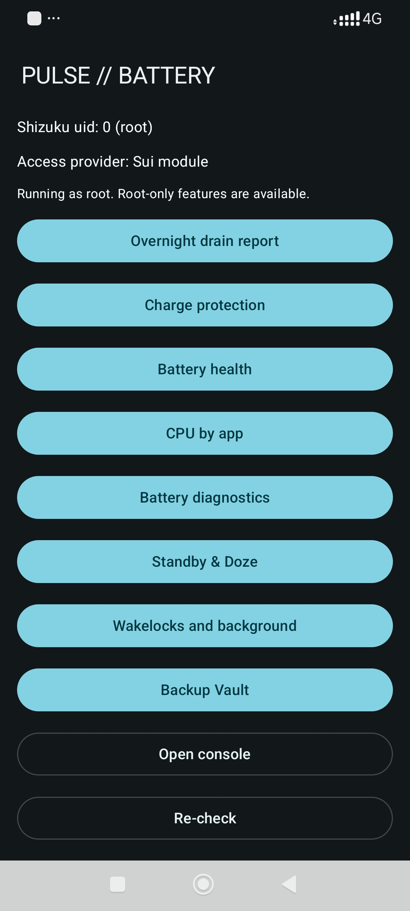
  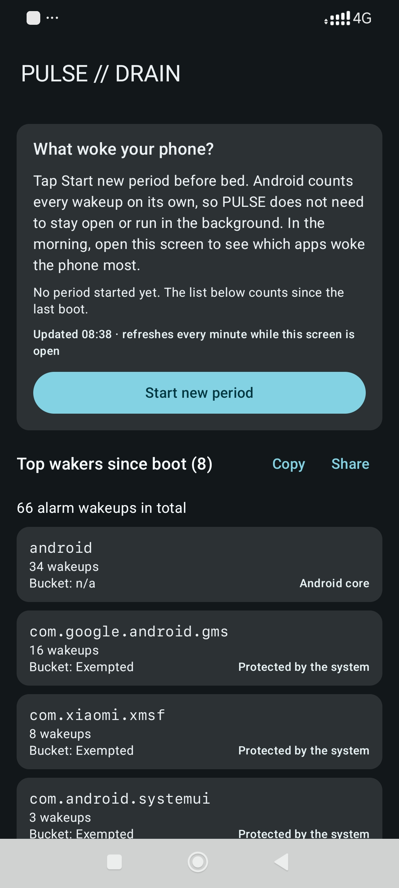
  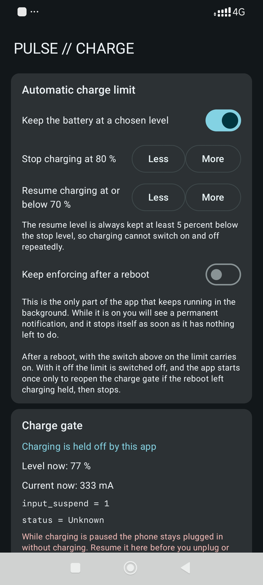
  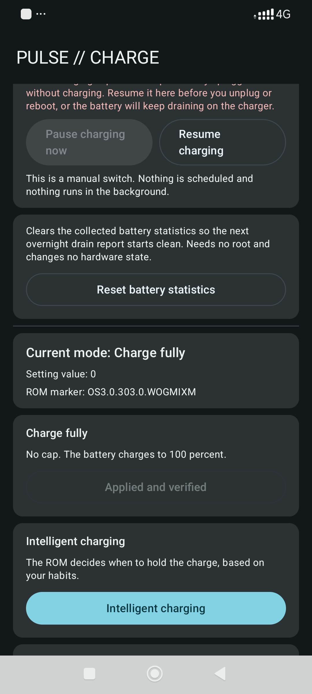
  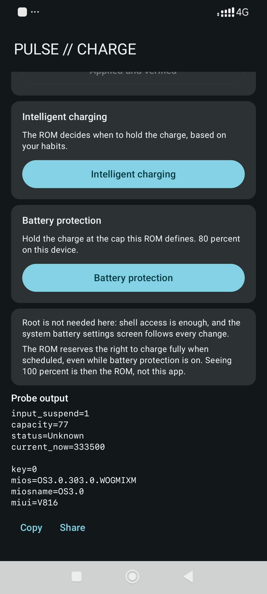
  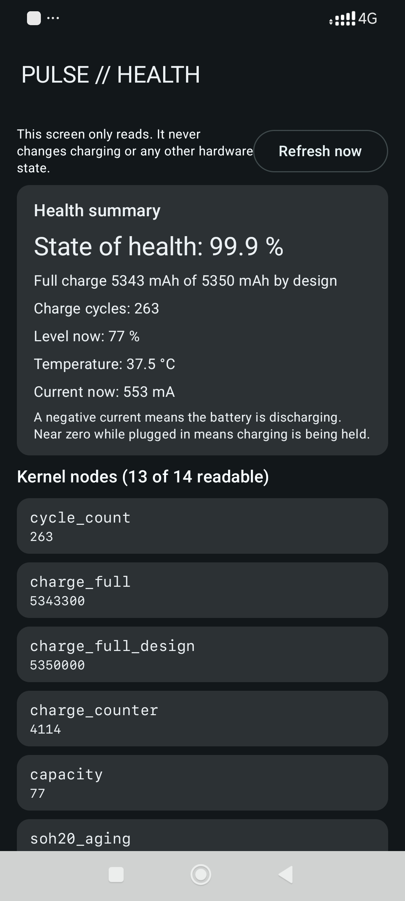
</p>
<p align="center">
  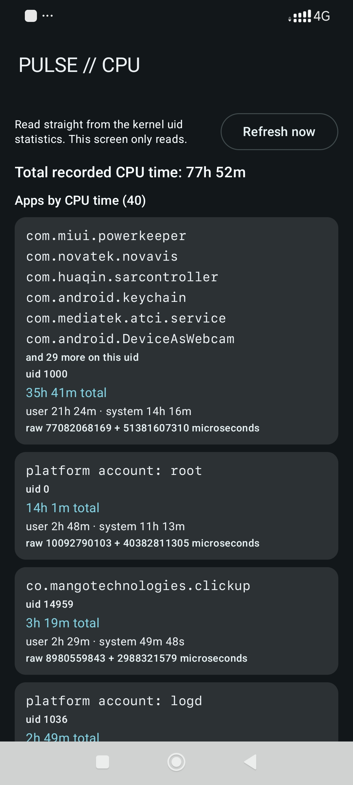
  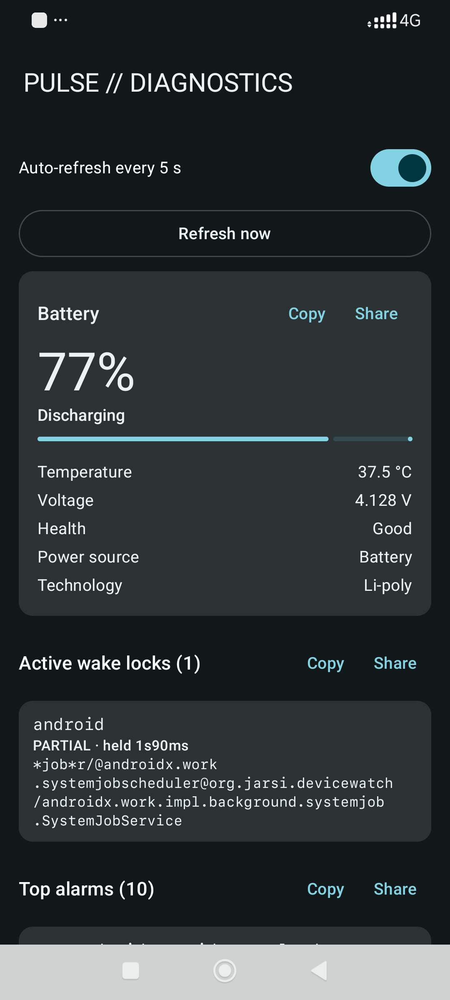
  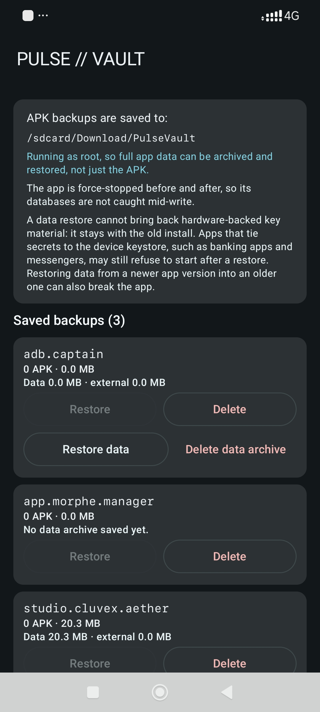
  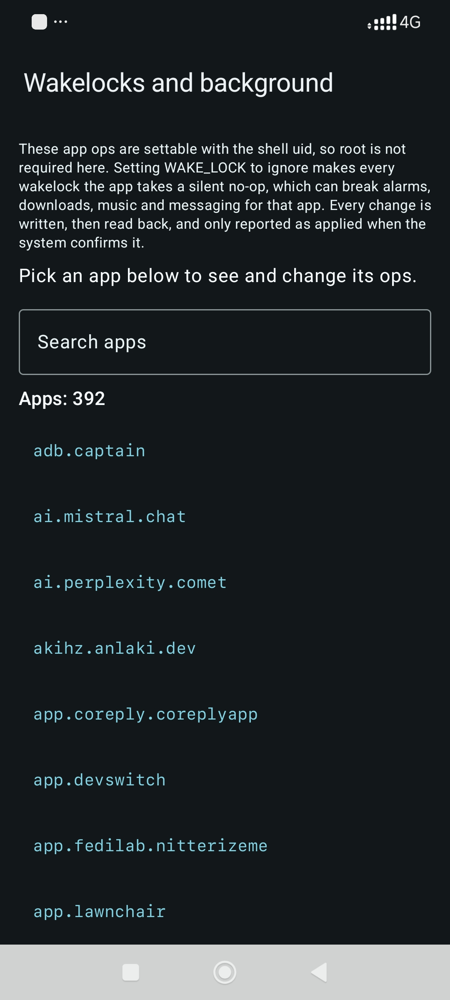
  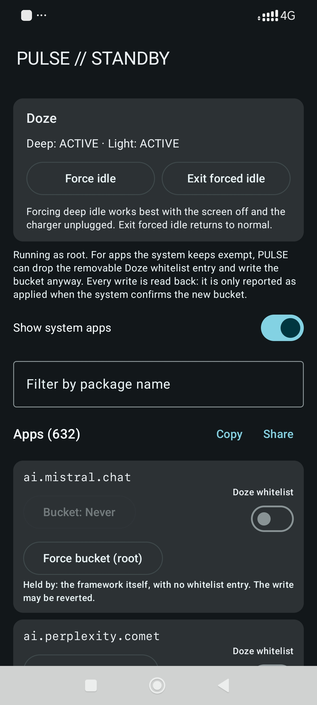
</p>

## Features

**Overnight drain report** (the headline)
- Tap *Start new period* before bed. In the morning: apps ranked by alarm wakeups, with a per-hour rate.
- One-tap **Restrict** moves an offender to the Restricted standby bucket. One-tap **Revert**.
- Android keeps the counters itself, so PULSE does not run in the background. Detects reboots.

**Diagnostics**
- Live battery state: level, temperature, voltage, health, power source.
- Active wake locks, attributed to the real package (including `*job*` tags).
- Top alarms table from `dumpsys alarm`.

**Standby & Doze**
- See and change the standby bucket of every app, with raw bucket codes shown.
- Add or remove apps from the user Doze whitelist.
- Force deep Doze on demand to test whether an app survives it.

**Wakelocks and background**
- Block an app's wakelocks and its background work per app, and put them back with one tap.
- Needs Shizuku only, no root.

**Vault (APK backup)**
- Export base + split APKs of any app to `Download/PulseVault`. Survives uninstalling PULSE.
- Restore with one tap.

**Console**
- Run any shell command as the Shizuku user, with 12 read-only quick commands, cancel, copy and share.

### With root

**Charge protection and charge limit**
- The three HyperOS charge modes, and a charge limit at any level you pick with a recharge floor.
- The limit is the one background component in the app: opt-in, permanent notification, stops itself.

**Battery health**
- Cycle count, full charge versus design capacity, voltage, current, temperature, manufacture date.

**CPU time per app**
- Read from the kernel uid statistics rather than from battery stats, so it is the real number.
- Platform accounts such as `root` and `logd` are named, and packages that share a uid are grouped.

**Standby override for protected apps**
- For an app the system keeps exempt, PULSE names *why* (your Doze whitelist, the ROM's own
  whitelist, or the framework), drops the removable entry and writes the bucket anyway.
- Verified by read-back, and a failed write puts the whitelist entry back.
- Tested: a third-party launcher held at `never` was moved to `restricted` and stayed there.
- Limit: some system packages have their bucket recomputed by the framework every few seconds
  (on the test phone, `android.miui.home.launcher.res` flips between exempted and active).
  No tool can hold a value the system rewrites that often. PULSE says the bucket is unstable
  and prints the system's own recorded reason instead of claiming success.

**Full app data backup and restore**
- Archives the whole private data directory plus external data and obb, and restores it.
- The app is stopped first, the archive is verified, ownership and SELinux labels are restored.

## Requirements

- Android 8.0 or newer.
- [Shizuku](https://shizuku.rikka.app/) running, or the Sui module. Wireless debugging, ADB or root.
- Root is optional. Without it everything above except the *With root* section works.
- No internet permission, no account, no ads, no trackers.

## Install

Download the APK from [Releases](https://github.com/kreza6173-pixel/pulse-battery/releases/latest).
On first launch PULSE asks Shizuku for permission. If Shizuku says allowed but PULSE still
asks, tap **Restart app** (some Shizuku builds apply a new grant only to a fresh process).

To get the root features, start Shizuku or Sui **as root** and pick the root option in its
permission dialog. The home screen shows which provider answered and the uid it runs with, so
you can see at a glance whether root features are available.

Release signing certificate SHA-256:

```
3f8c1e2df2deaf9d561a8fdce3c667ed0ceda972622f20d006a1b6098c2a2512
```

## FAQ

**Is Restrict safe?** It uses the same standby-bucket API Android itself uses. Restricted apps
still work when you open them; their background jobs and alarms just run rarely. Messaging
apps may deliver notifications late, so do not restrict the ones you need instantly.
Revert is one tap, or change the bucket anytime in *Standby & Doze*.

**Why alarm wakeups and not mAh?** Per-app mAh estimates are unreliable across vendors and
Android versions. Wakeups are counted by the system, are exact, and are the usual cause of
overnight drain.

**Some apps say "Held by the system".** Android marks core and some vendor apps as exempted.
Without root their bucket cannot be changed and PULSE does not pretend otherwise. With root it
will attempt the change, tell you what was holding the app, and verify the result. If the
system takes the bucket straight back, you see that, with the reason the system recorded.

**Does PULSE drain battery itself?** No, with one disclosed exception: the automatic charge
limit has to watch the battery level, so while it is on you will see a permanent notification.
It stops itself when it has nothing left to do. Nothing else runs while the app is closed.

**Can a data restore bring back my logins?** Usually, but not secrets an app encrypts with an
Android Keystore key. That key never leaves the phone's secure hardware and is deleted when you
clear the app's data, so the encrypted file comes back unreadable. No root tool can change
this. Export an authenticator app's own backup before testing a restore on it.

## How it works

| Feature | Command |
|---|---|
| Drain report | `dumpsys alarm` (Alarm Stats per-package totals) |
| Battery | `dumpsys battery` |
| Wake locks | `dumpsys power` |
| Standby bucket | `am get-standby-bucket` / `am set-standby-bucket` |
| Standby reason | `dumpsys usagestats`, current row only |
| Doze whitelist | `dumpsys deviceidle whitelist +pkg` / `-pkg` |
| Force Doze | `dumpsys deviceidle force-idle` / `unforce` |
| Wakelocks, background | `cmd appops set <pkg> WAKE_LOCK\|RUN_IN_BACKGROUND\|RUN_ANY_IN_BACKGROUND` |
| APK export | `pm path` then `cp` |
| APK restore | staged in `/data/local/tmp`, then `pm install -r` |
| Charge protection (root) | secure setting `security_pc_secure_protect_mode_key` |
| Charge gate and limit (root) | `/sys/class/power_supply/battery/input_suspend` |
| Battery health (root) | `/sys/class/power_supply/*` |
| CPU per app (root) | `/proc/uid_cputime/show_uid_stat`, names from `id -nu` |
| Data backup (root) | `tar` inside init's mount namespace, then `chown` and `restorecon` |

All parsers are pure Kotlin, unit-tested against real device output. Package names are
validated and shell-quoted before any command runs. Full detail, including the eight features
that were deliberately **not** shipped and why, is in [docs/ROOT_MODE.md](docs/ROOT_MODE.md).

## Build

CI is the build system: every push builds, tests, lints and uploads `app-debug`.
With signing secrets present it also builds a signed `app-release`. See [docs/RELEASE.md](docs/RELEASE.md).

Toolchain: AGP 8.13.1, Kotlin 2.2.21, Gradle 8.13, Compose BOM 2025.12.00, compile/target SDK 36,
Shizuku API 13.1.5.

## Support

PULSE is free, open source and has no ads or trackers, built in spare time. If it saved your
battery, you can [support the work with a small crypto donation](https://github.com/kreza6173-pixel/kreza6173-pixel/blob/main/DONATE.md)
(USDT on TRC20, or USDC / SOL on Solana). A star helps other people find it, and contributions
and bug reports are welcome, see [CONTRIBUTING.md](CONTRIBUTING.md).

## License

MIT, see [LICENSE](LICENSE). Uses Shizuku-API (MIT), AndroidX, Jetpack Compose and Kotlin
(Apache-2.0).
